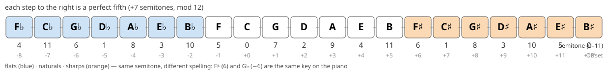
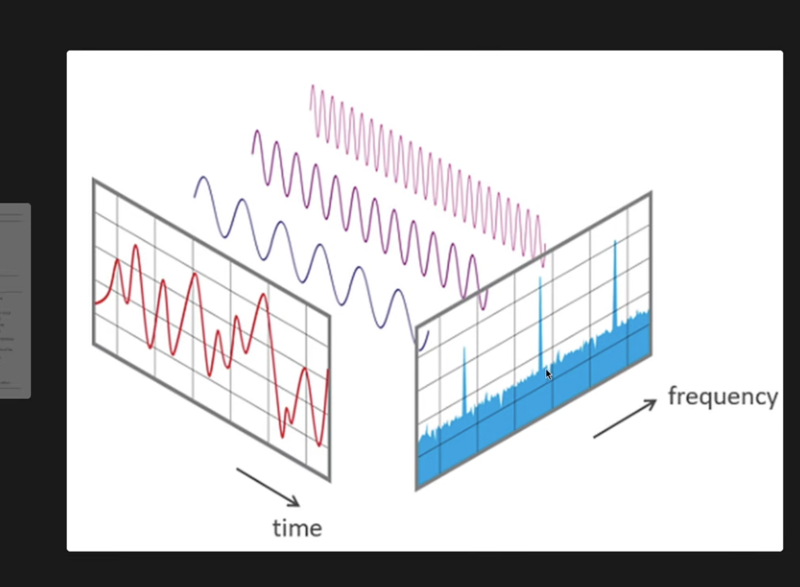
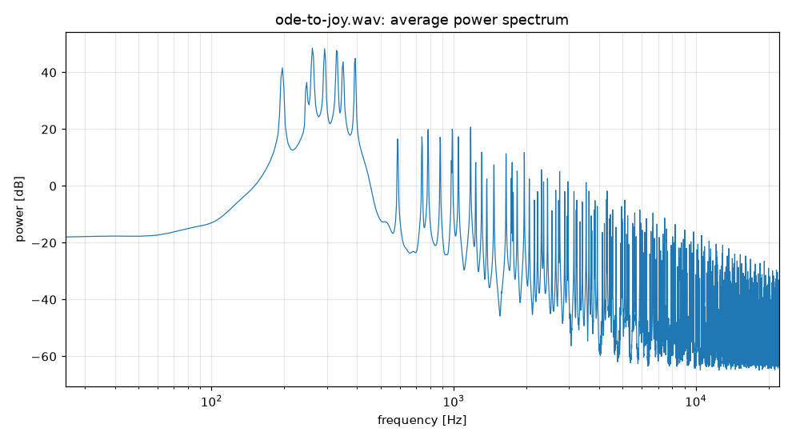
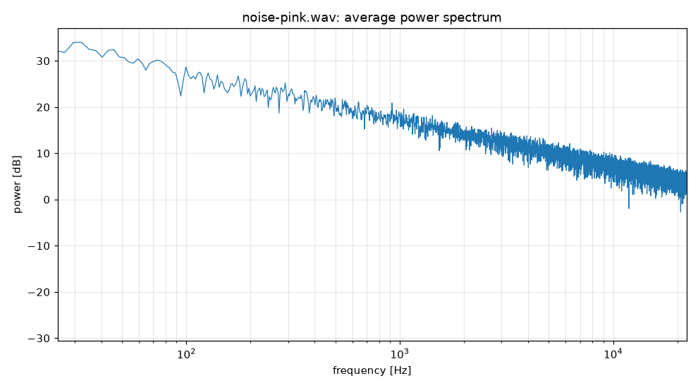

# Theory notes

Background for the types in `src/Tonwerk/Theory` and for the sounds the apps generate.

## harmonies

the three basic harmonies in C major are:
(see below for the roman numerals )

```plain
I = C = C E G
IV = F = F A C
V7 = G7 = G B D F
```

## Scale

A scale is a collection of notes in ascending order. The major scale is built from the step pattern whole-whole-half-whole-whole-whole-half (2 2 1 2 2 2 1 semitones), so the C major scale uses only the white keys: `C D E F G A B`

The names second, third, fourth, fifth, sixth, seventh, octave refer to positions in the scale.

For example from C:

```plain
C D E F G A B C
1 2 3 4 5 6 7 8
```

## Key

A key adds tonal hierarchy and harmonic function.

When we say a piece is "in C major", we mean:

- The notes primarily come from the C major scale.
- C is heard as the tonal center ("home").
- Chords and melodies create expectations that resolve to C.

for example:

```plain
C  -> feels like home
F  -> away from home
G7 -> wants to return home
C  -> home again
```

That feeling comes from the key, not merely from the scale.

## scale degrees

The Roman numerals identify chords relative to the tonic (the home chord) of the _key_:

In C major, the scale is:
C D E F G A B
1 2 3 4 5 6 7

the degrees describe a chord's function within a key, independent of the actual chord names.

```plain
I    = C E G = C major
ii   = D F A = D minor
iii  = E G B = E minor
IV   = F A C = F major
V    = G B D = G major
vi   = A C E = A minor
vii° = B D F = B diminished
```

- Uppercase numerals mean major chords: I IV V
- Lowercase numerals mean minor chords: ii iii vi
- The ° symbol indicates diminished chords: vii°

## semitone distances

An interval's name counts scale positions, not semitones.

for example `C -> G = fifth` because G is the 5th note name counting inclusively:

```plain
C(1) D(2) E(3) F(4) G(5)
```

| Interval       |       | # Semitones |
| -------------- | ----- | ----------- |
| Perfect unison | P1    | 0           |
| Minor second   | m2    | 1           |
| Major second   | M2    | 2           |
| Minor third    | m3    | 3           |
| Major third    | M3    | 4           |
| Perfect fourth | P4    | 5           |
| Tritone        | A4/d5 | 6           |
| Perfect fifth  | P5    | 7           |
| Minor sixth    | m6    | 8           |
| Major sixth    | M6    | 9           |
| Minor seventh  | m7    | 10          |
| Major seventh  | M7    | 11          |
| Perfect octave | P8    | 12          |

Why "perfect", "major" and "minor"?

Unisons, fourths, fifths and octaves come in only one common size, which is why they are called *perfect*. Seconds, thirds, sixths and sevenths come in two sizes, a semitone apart: the larger is *major*, the smaller *minor* (a minor third is 3 semitones, a major third 4). A fourth enlarged by a semitone, or a fifth shrunk by one, is the *tritone* (6 semitones, written A4 or d5).

## Intervals used in common chords

Major triad:

```plain
C E G
 
Root -> E = M3 = 4 semitones
Root -> G = P5 = 7 semitones
```

Minor triad:

```plain
C Eb G
 
Root -> Eb = m3 = 3 semitones
Root -> G = P5 = 7 semitones
```

Dominant seventh:

```plain
G7 = G B D F
 
G -> B = M3 ( 4 semitones )
G -> D = P5 ( 7 semitones )
G -> F = m7 ( 10 semitones )
```

Major seventh:

```plain
Cmaj7 = C E G B
 
C -> E = M3 ( 4 semitones )
C -> G = P5 ( 7 semitones )
C -> B = M7 ( 11 semitones )
```

## Pitch classes and the line of fifths

A *pitch class* is a note name without an octave: every C, in every octave, is the pitch class C. Spelling still matters: F♯ and G♭ are the same key on the piano (the same *semitone*, 6 above C) but different pitch classes, because they play different roles in a key.

`PitchClass` represents a spelled pitch class by a single number, its `Offset`: how many perfect fifths it lies from C. Stacking fifths from C gives the **line of fifths**:



From the offset everything else follows:

- `Semitone = (7 × Offset) mod 12`, because a fifth is 7 semitones. Twelve fifths (offset 12, B♯) land back on semitone 0, which is why B♯ and C are the same key.
- `Letter` comes from the offset modulo 7: going up a fifth moves four letter names (C → G → D → A → E → B → F♯…).
- `Accidental` is the number of full 7-step wraps: offsets −8 … −2 are flat (F♭ … B♭), −1 … 5 are natural (F C G D A E B), and 6 … 12 are sharp (F♯ … B♯).

`PitchClass.All` lists these 21 spellings in order, and `scripts/gen_pitch_classes.cs` prints them as constants together with their enharmonic synonyms (equal `Semitone`, different `Offset`).

Neighbours on this line are closely related harmonically, which is why the line is a good backbone for key and chord logic: the notes of a major key are always seven consecutive elements of it (C major = F C G D A E B, offsets −1 … 5).

## Time domain and frequency domain

A sound is a sequence of samples over time (a `Track`). The same sound can be described as a sum of sine waves, each with a frequency and a strength; that description is its *spectrum*, and the Fourier transform converts between the two views.



The red curve on the left is what the speaker plays, and what a WAV file stores. It is the sum of the sine waves in the middle. On the right each of those sine waves shows up as one spike at its frequency, with the height giving its strength. The blue floor under the spikes is noise.

How the generated files look in the frequency domain (`scripts/plot.py` plots the average spectrum of any WAV file):

- **A note** is a sine wave (or another periodic wave) at the pitch's frequency. A sine is a single spike; square, sawtooth and triangle waves add overtones at multiples of the frequency (square: odd multiples; sawtooth: all, falling off as 1/n).
- **A chord** is several notes sounding together. In the time domain that is just adding their samples (`Track.Sum`, `Track.Mix`); in the frequency domain it is the union of their spikes. So the spectrum of `ode-to-joy.wav` is peaks at the melody and chord pitches and their overtones, falling off towards high frequencies:

  

- **Noise** has no spikes: its energy is spread over a continuous range of frequencies. The "colors" differ in how the power falls off with frequency (power ∝ 1/f^α): white is flat (α = 0), pink falls 3 dB per octave, brown 6 dB per octave, blue and violet rise by 3 and 6 dB per octave. On the log-frequency axis of the plot, each color is a straight line:

  

There are two ways to make noise of a given color. `Noise.Generate` works in the time domain by filtering random samples, which is cheap and never repeats. `Tonwerk.Noise --spectral` works in the frequency domain: it chooses a random phase and the right magnitude for every frequency and applies the inverse Fourier transform. That is exact for the slope, but it produces one fixed-length block. Tones and chords need no Fourier transform at all: adding sine waves in the time domain is already the "inverse transform" of the spikes.

## Ratios and tuning

A note is a stack of overtones at whole-number multiples of its frequency: f, 2f, 3f, 4f, … Two notes sound consonant when their frequencies stand in a small whole-number ratio, because their overtones then coincide instead of beating against each other. The simpler the ratio, the more overtones coincide and the more stable the interval sounds:

| Interval      | Just ratio | Why it fits                                                      |
| ------------- | ---------- | ---------------------------------------------------------------- |
| Octave        | 2:1        | every overtone of the upper note is also one of the lower note   |
| Perfect fifth | 3:2        | the 3rd overtone of the lower note is the 2nd of the upper note  |
| Perfect fourth | 4:3       |                                                                  |
| Major third   | 5:4        |                                                                  |
| Minor third   | 6:5        |                                                                  |

A major triad in just intonation is the frequencies 4 : 5 : 6 (C E G = 264 : 330 : 396 Hz for a C of 264 Hz), a minor triad 10 : 12 : 15.

### Equal temperament

A piano (and `Pitch.Frequency`) uses twelve-tone equal temperament: the octave is divided into 12 equal steps, each a factor of 2^(1/12). That number is irrational, so no equal-tempered interval except the octave is an exact fraction. The approximations (100 cents = 1 semitone):

| Interval      | Equal-tempered ratio | Just ratio | Error           |
| ------------- | -------------------- | ---------- | --------------- |
| Perfect fifth | 2^(7/12) = 1.4983    | 1.5        | 2 cents flat    |
| Perfect fourth | 2^(5/12) = 1.3348   | 1.3333     | 2 cents sharp   |
| Major third   | 2^(4/12) = 1.2599    | 1.25       | 14 cents sharp  |
| Minor third   | 2^(3/12) = 1.1892    | 1.2        | 16 cents flat   |

Fifths and fourths are almost pure; the thirds are audibly off. That is why a choir or string quartet that tunes its thirds by ear sounds subtly different from a piano.

### The comma, and why the line of fifths wraps

Stack 12 pure fifths and you get (3/2)^12 = 129.75, but seven octaves are 2^7 = 128. The two differ by a factor of 1.0136, about 23.5 cents: the *Pythagorean comma*. With pure tuning the line of fifths therefore never closes: B♯ ends up slightly higher than C, and F♯ differs from G♭.

Equal temperament shaves one twelfth of the comma off every fifth, so that the line closes after 12 steps. In `PitchClass` terms:

- `Offset` identifies a spelling, one position on the (open) line of fifths, so B♯ (12) and C (0) are different pitch classes.
- `Semitone = (7 × Offset) mod 12` is the equal-temperament collapse that makes them the same key, and therefore the same frequency.

Equal temperament trades pure thirds for the freedom to play in every key with the same tuning.

> **TODO:** hear the difference. Render a major triad (and a short progression) once in just intonation (4 : 5 : 6) and once equal-tempered, and compare the sound and the spectra. See the README's TODO list.

